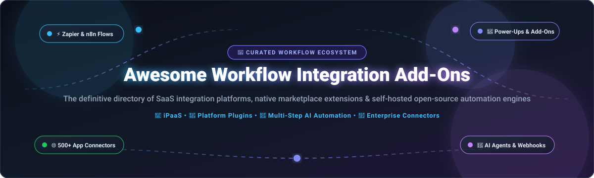

# ⚡ Awesome Workflow Integration Add-Ons 🔌

**Curated directory of SaaS workflow platforms, native marketplace extensions, iPaaS solutions, and open-source automation infrastructure.**

*Bridging work management apps—Trello, Jira, Slack, Miro, ClickUp, Monday, Asana—with automation, connectors, and AI agents.*

---

## 📑 Table of Contents

- [📊 Sector Overview & Market Dynamics](#-sector-overview--market-dynamics)
- [🏢 SaaS & Hosted Platforms](#-saashosted-platforms)
- [💻 Open-Source GitHub Projects](#-open-source-github-projects)
  - [⚡ Workflow Automation & iPaaS Platforms](#-workflow-automation--ipaas-platforms)
  - [🤖 AI-Native Workflow & Agentic Orchestration](#-ai-native-workflow--agentic-orchestration)
  - [📋 Project & Work Management Alternatives](#-project--work-management-alternatives)
- [🤝 How to Contribute](#-how-to-contribute)
- [💖 Support & Community](#-support--community)
- [📈 Star History](#star-history)
- [⚖️ Disclaimer & Security Considerations](#️-disclaimer--security-considerations)

---

## 📊 Sector Overview & Market Dynamics

The global **Integration Platform as a Service (iPaaS) and workflow automation market** is estimated at **$13.5 Billion in 2026** and is projected to surpass **$38 Billion by 2031**, expanding at a compound annual growth rate (CAGR) exceeding **23%**. 

Market dynamics demonstrate a **moderately fragmented, dual-tier structure**:
- **Enterprise iPaaS & System Consolidation**: Dominated by high-capitalization incumbents and cloud hyperscalers (Salesforce/Slack/MuleSoft, Atlassian, Workato) capturing deep ERP and IT governance workflows.
- **Mid-Market & Long-Tail Extensions**: A fiercely competitive and fragmented ecosystem composed of visual no-code orchestrators (Zapier, Make), specialized marketplace ecosystems (Trello Power-Ups, Miro Marketplace), and a fast-growing cohort of **open-source, self-hosted alternatives** (n8n, Activepieces, Windmill) driving local data sovereignty and AI agent orchestration.

---

## 🏢 SaaS/Hosted Platforms

The table below compiles leading hosted automation engines and native marketplace platforms, ranked descending by estimated company size (market capitalization / enterprise valuation / ARR).

| Platform | Category / Primary Capability | Starting Tier Pricing | Free Tier Limit / Trial Specifics | Company Size / Valuation / Revenue |
| :--- | :--- | :--- | :--- | :--- |
| **[Slack Integrations](https://slack.com/apps)** | Team Chat & App Hub | **$7.25 / user / mo** *(Pro tier billed annually)* | **Free forever**: 90-day message history, 1:1 Huddles, and up to **10 app integrations** | **~$27.7 Billion** *(Acquired by Salesforce; Salesforce Market Cap ~$280B)* |
| **[Jira Plugins (Atlassian Marketplace)](https://marketplace.atlassian.com/)** | Issue Tracking & DevOps Apps | **$7.75 / user / mo** *(Standard tier billed annually)* | **Free forever**: Up to **10 users**, 2 GB file storage, unlimited project boards | **~$48.0 Billion** *(Atlassian NASDAQ: TEAM Market Cap)* |
| **[Asana Apps](https://asana.com/apps)** | Enterprise Work & Portfolio Tracking | **$10.99 / user / mo** *(Starter tier billed annually)* | **Free forever**: Up to **10 teammates**, unlimited tasks, projects, and 100+ app integrations | **~$3.2 Billion** *(Asana NYSE: ASAN Market Cap)* |
| **[Monday Apps](https://monday.com/marketplace)** | Work OS & Custom Workflows | **$9.00 / seat / mo** *(Basic tier, min 3 seats billed annually = $27/mo)* | **Free forever**: Up to **2 seats**, 3 boards, 200+ templates, 500 MB storage | **~$12.5 Billion** *(monday.com NASDAQ: MNDY Market Cap)* |
| **[Trello Power-Ups](https://trello.com/power-ups)** | Visual Kanban & Board Extensions | **$5.00 / user / mo** *(Standard tier billed annually)* | **Free forever**: Up to **10 workspace boards**, unlimited cards, and **unlimited Power-Ups** per board | **~$3.0+ Billion** *(Part of Atlassian ecosystem; acquired for $425M in 2017)* |
| **[Zapier](https://zapier.com/)** | Multi-App No-Code iPaaS | **$19.99 / mo** *(Starter tier, 750 tasks/mo billed annually)* | **Free forever**: **100 tasks/month**, single-step Zaps, 15-minute update frequency | **~$5.0 Billion** *(Valuation; ~$250M+ ARR)* |
| **[Workato](https://www.workato.com/)** | Enterprise Automation & Integration | **~$10,000 / year base** *(Base workspace + per-recipe pack model)* | **14-day free trial**: Access to community connectors and recipe sandbox environment | **~$5.7 Billion** *(Series E valuation; $150M+ ARR)* |
| **[ClickUp Integrations](https://clickup.com/integrations)** | All-in-One Collaboration & Tasks | **$7.00 / user / mo** *(Unlimited tier billed annually)* | **Free forever**: **100 MB storage**, unlimited tasks, and up to **100 native automation executions/month** | **~$4.0 Billion** *(Valuation)* |
| **[Miro Add-ons (Marketplace)](https://marketplace.miro.com/)** | Visual Collaboration & Canvas Extensions | **$8.00 / member / mo** *(Starter tier billed annually)* | **Free forever**: **3 editable boards**, premade templates, and core marketplace integrations | **~$17.5 Billion** *(Valuation)* |
| **[Make](https://www.make.com/)** | Visual Workflow Orchestration | **$9.00 / mo** *(Core tier, 10,000 operations/mo billed annually)* | **Free forever**: **1,000 operations/month**, 15-minute minimum interval, 2 active scenarios | **~$1.0+ Billion** *(Acquired by Celonis; Celonis Valuation ~$13.0B)* |

---

## 💻 Open-Source GitHub Projects

Explore open-source workflow automation engines, self-hostable iPaaS alternatives, and project management platforms with extensive integration ecosystems. Ranked descending by GitHub Stars_Count.

### ⚡ Workflow Automation & iPaaS Platforms

| Project | GitHub_Stars | License | Core Capabilities & Architecture |
| :--- | :---: | :---: | :--- |
| **[n8n](https://github.com/n8n-io/n8n)** |  | Sustainable Use License | Fair-code visual workflow automation platform with 1,500+ connectors, AI agent workflows, and native JS/Python scripting. |
| **[Node-RED](https://github.com/node-red/node-red)** |  | Apache-2.0 | Low-code event-driven programming for wiring together hardware devices, APIs, and online services via a browser editor. |
| **[Activepieces](https://github.com/activepieces/activepieces)** |  | MIT | Self-hosted Zapier/Make alternative featuring 500+ pre-built pieces, Copilot workflow builder, and Model Context Protocol (MCP) support. |
| **[Windmill](https://github.com/windmill-labs/windmill)** |  | AGPL-3.0 | Extremely fast developer platform for turning Python, TypeScript, Go, Bash scripts and SQL into endpoints, UIs, and workflows. |
| **[Huginn](https://github.com/huginn/huginn)** |  | MIT | Hackable open-source system for building personal agents that monitor the web, scrape data, and trigger automated HTTP/email actions. |
| **[Kestra](https://github.com/kestra-io/kestra)** |  | Apache-2.0 | Declarative, event-driven orchestrator managing workflows across business APIs, data pipelines, and microservices in code or UI. |
| **[AutoKitteh](https://github.com/autokitteh/autokitteh)** |  | Apache-2.0 | Durable code-first workflow engine powered by Temporal for executing long-running Python/Starlark integration logic reliably. |
| **[FlowForge](https://github.com/DeveloperSarim/FlowForge)** |  | AGPL-3.0 | Self-hosted n8n/Zapier alternative optimized for PHP shared hosting environments with 1,690+ app integrations and cron scheduling. |
| **[ByteChef](https://github.com/bytechef/bytechef)** |  | Apache-2.0 | Open-source low-code API integration engine designed for Java enterprise stacks and embedded iPaaS applications. |

---

### 🤖 AI-Native Workflow & Agentic Orchestration

| Project | GitHub_Stars | License | Core Capabilities & Architecture |
| :--- | :---: | :---: | :--- |
| **[Flowise](https://github.com/flowiseai/flowise)** |  | MIT | Drag-and-drop UI to build customized LLM flows, multi-agent orchestrations, and connect AI models with enterprise APIs. |
| **[Paca](https://github.com/Paca-AI/paca)** |  | Apache-2.0 | AI-native team collaboration hub with integrated MCP server, enabling AI agents and human developers to collaborate on sprints. |

---

### 📋 Project & Work Management Alternatives

| Project | GitHub_Stars | License | Core Capabilities & Architecture |
| :--- | :---: | :---: | :--- |
| **[Plane](https://github.com/makeplane/plane)** |  | AGPL-3.0 | Modern open-source Jira/Linear replacement featuring sprints, kanban, gantt, documents, and webhooks. |
| **[NocoDB](https://github.com/nocodb/nocodb)** |  | AGPL-3.0 | Open-source Airtable alternative that turns any MySQL, PostgreSQL, or SQLite database into an interactive smart spreadsheet with webhook integrations. |
| **[Appsmith](https://github.com/appsmithorg/appsmith)** |  | Apache-2.0 | Low-code framework to build internal tools, dashboards, and admin panels connected directly to business databases and REST/GraphQL APIs. |
| **[ToolJet](https://github.com/tooljet/tooljet)** |  | AGPL-3.0 | Extensible low-code platform for building customized workflow applications and internal business extensions. |
| **[WeKan](https://github.com/wekan/wekan)** |  | MIT | Mature, battle-tested Trello alternative with direct import capabilities for Trello, Jira, and Asana boards. |
| **[Leantime](https://github.com/leantime/leantime)** |  | AGPL-3.0 | Strategic project management platform combining lean methodology, kanban boards, and Slack/Mattermost/Discord integration. |
| **[Kanboard](https://github.com/kanboard/kanboard)** |  | MIT | Minimalist, self-hosted kanban board with automated background actions, plugin system, and LDAP integration. |
| **[Vikunja](https://github.com/go-vikunja/vikunja)** |  | AGPL-3.0 | Multi-view task management tool (Kanban, List, Gantt, Table) with Trello/Todoist migration and webhooks. |
| **[Kan](https://github.com/kanbn/kan)** |  | MIT | Next.js and tRPC-powered Kanban board featuring one-click Trello JSON board import. |
| **[Windshift](https://github.com/windshiftapp/core)** |  | AGPL-3.0 | Single Go binary Jira/Confluence alternative with service management SLAs, JQL query language, and Jira importer. |

---

## 🤝 How to Contribute

Contributions to expand this repository are warmly encouraged!

1. 🍴 **Fork** the repository.
2. 🌿 **Create** a descriptive branch (`git checkout -b feat/add-connector-tool`).
3. ✏️ **Add** entries following the table format (include official links, pricing/license, and badges).
4. 🚀 **Submit** a Pull Request with a summary of the added platform or library.

---

## 💖 Support & Community

Thank you so much for visiting and supporting **Awesome Workflow Integration Add-Ons**! If you find this curated collection helpful for your projects, architecture planning, or engineering workflows, please consider:

- ⭐ **Starring** the repository on GitHub to help others discover it.
- 🍴 **Forking** and contributing new tools, integrations, and corrections.
- 📢 **Sharing** this repository with your network, team, and tech communities.
- ☕ **Buying a coffee** to fuel ongoing maintenance and development via the [Sponsor Dashboard](https://github.com/sponsors/ishandutta2007).

---

##  Star History

---

## ⚖️ Disclaimer & Security Considerations

- 🔒 **Data Privacy & Credentials**: Workflow automation tools handle sensitive API keys, OAuth tokens, and confidential company payload data. Always follow least-privilege principles and verify secret encryption at rest.
- 📦 **Licensing Compliance**: Verify commercial rights prior to self-hosting. MIT and Apache-2.0 permit free commercial deployment; AGPL-3.0 and Sustainable Use Licenses may impose restrictions on hosted redistribution.
- 🧩 **Native Ecosystem Limitations**: While open-source automation platforms (n8n, Activepieces) excel at backend API orchestration, deep in-client extensions (such as Trello Power-Ups and Atlassian Forge UI modules) still rely on proprietary host platform APIs.

---

  Maintained for integration architects, DevOps teams, and automation engineers worldwide.

